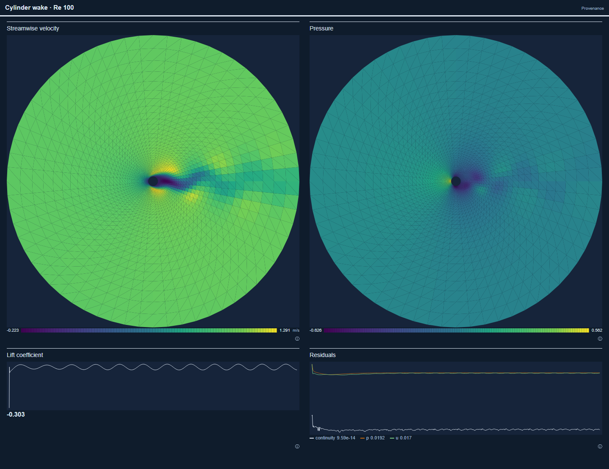
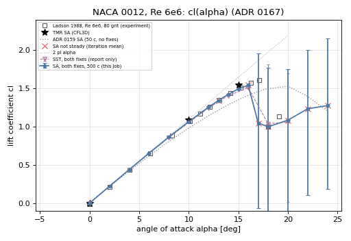
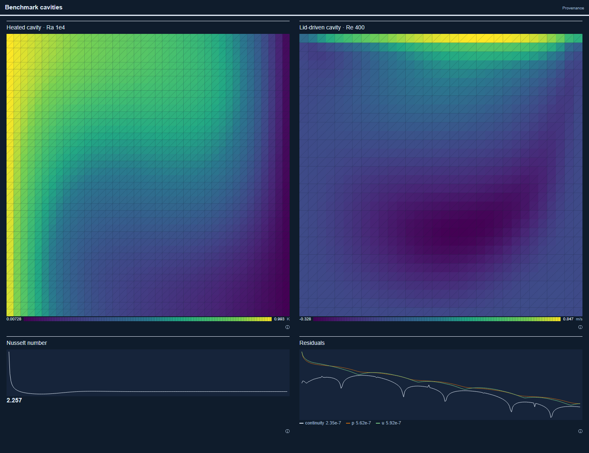
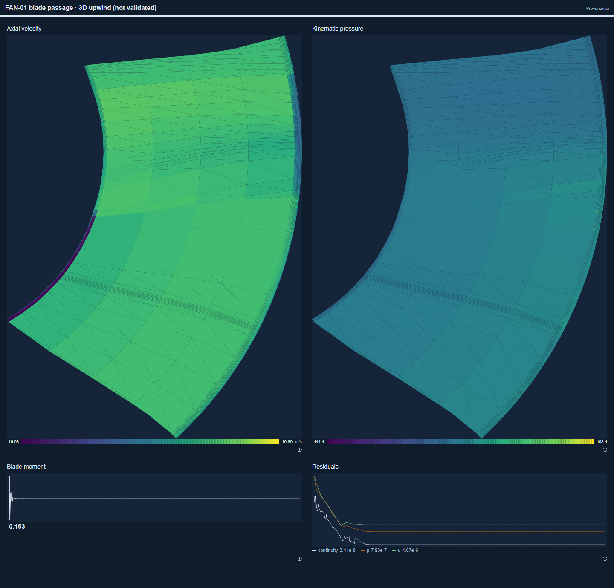

# rcfd

**rcfd** is a clean-room, open-source (**AGPL-3.0**, with a [commercial licence](COMMERCIAL-LICENSE.md)) computational fluid dynamics (CFD) suite written in pure, safe Rust (`unsafe_code = "forbid"`), with an early finite-element structural solver (`rcfd-fem`), a Python interface, an MCP server for AI agents, and a desktop Studio canvas.

**Goal.** Build an open-source simulation toolset covering commercial CFD and multiphysics workflows so learners, researchers and small teams can run trustworthy simulations and build products on top of it. The flagship engineering target is **AI-assisted design of a 120 mm axial computer fan** — iterating on geometry for airflow, noise, vibration and manufacturing tolerances ([fan milestone](docs/milestone-fan.md), [fan breakdown](docs/fan-project-breakdown.md)).

> **Early-stage software:** rcfd has **not** been validated for engineering decisions, must **not** be used for safety-critical work, and comes with no warranty of any kind (see [Licence](#licence)). Numeric tolerances are registered in advance and known misses are kept visible rather than tuned away.



*Real solver output from `example-projects/wind-tunnel` (`cylinder-re100.toml`, coarse demonstration mesh — not a validation), rendered by `rcfd-mcp`'s `export_view` using Studio's stylesheet, Viridis colour table and per-panel provenance hashes.*

## Why rcfd?

* **AI-native by design:** One shared workspace layer (`rcfd-workspace`) backs the CLI, the MCP server (`rcfd-mcp`) and the Studio desktop canvas. Agents edit cases with compare-and-set conflict checks, run background jobs via `rcfd-runner`, log every action in a project journal, and render live views (`show_view`) or self-contained HTML reports (`export_view`).
* **Pure safe Rust:** Single native binaries with no `unsafe` code, no shell-sourced runtime environment, and deterministic replay from case files.
* **Pre-registered verification:** Every feature registers its checks and numeric limits in `docs/adr/` *before* code is written; misses stay in the test suite as recorded `known_miss` cases.
* **Clean-room:** Algorithms come from published literature or first principles, never proprietary code, binaries or manuals ([provenance record](docs/provenance.md), [CONTRIBUTING.md](CONTRIBUTING.md)).

## What works today

| Area | Available today |
| :--- | :--- |
| **Flow solvers** | Unstructured finite-volume incompressible steady & transient (`SIMPLE`, `SIMPLEC`, `PISO`, `PIMPLE`), compressible Euler (`HLLC`, `Roe`, `AUSM`, `MUSCL`, explicit RK3 / implicit), energy & Boussinesq buoyancy, species transport, porous media, MRF rotating frames, rotor-stator sliding mesh (`[mesh.sliding]`, laminar PISO/PIMPLE), one-way Lagrangian particles. |
| **Turbulence** | Spalart-Allmaras, $k$-$\varepsilon$ (standard, RNG, realizable), $k$-$\omega$ SST / BSL, wall-function & near-wall treatments. |
| **Meshes & I/O** | Built-in parametric generators (cavities, channels, wedges, cylinders, NACA aerofoils, axial-fan sectors), mesh quality checker, import from Gmsh, Fluent (`.msh`/`.cas`) and OpenFOAM (`polyMesh`), export to VTK (`.vtu`), GLB derived views (cut planes, iso-surfaces, streamlines, vectors) and self-contained HTML. |
| **Design & UQ** | Parametric sweeps, operating maps with warm restarts, Nelder-Mead & CMA-ES optimisation, Monte Carlo / LHS uncertainty quantification, Sobol sensitivity indices, append-only design ledger. |
| **Interfaces** | `rcfd` CLI, JSON-RPC solver service (`rcfd serve`), background job runner (`rcfd-runner`), stdio MCP server (`rcfd-mcp`), pure-Python wrapper (`python/rcfd`), sandboxed WebAssembly UDFs ([docs/udf-abi.md](docs/udf-abi.md)), optional CUDA linear solvers ([docs/gpu.md](docs/gpu.md)), Electron Studio canvas (`apps/studio-web/`). |
| **Structural FEA** | Early finite-element solid solver (`rcfd-fem`) for static loads and modal analysis; library & solid case file only, not yet validated against measurements ([docs/structural-solver.md](docs/structural-solver.md)). |

## Progress and validation status

### Simulation milestones

Each milestone tracks the roadmap items needed to set up, run and trust a named simulation. **Headline result** is **met** only when every comparison against its published reference passes its pre-registered limit ([full details and citations](docs/roadmap-overview.md#simulation-milestones)):

| Milestone | Roadmap items landed | Headline result |
| :--- | :---: | :--- |
| Packed bed pressure drop (Ergun) | 100% (14/14) | **Met** |
| Lid-driven cavity (Ghia et al., Re 100–1000) | 96% | **Met** |
| Differentially heated cavity (de Vahl Davis, Ra $10^3$–$10^6$) | 96% | **Met** |
| Shock tube & oblique shock wedge (Sod / $\theta$-$\beta$-$M$) | 94% | **Met** |
| Vortex shedding behind a cylinder (Re 100, $St$ & $C_D$) | 92% | **Met** |
| Aerofoil lift (NACA 0012, Re $6\times 10^6$) | 92% | Not met *(lift curve met; SST/wall-treatment clauses open)* |
| Turbulent backward-facing step (Driver & Seegmiller) | 88% | Not met |
| Turbulent flat plate skin friction (NASA TMR) | 86% | Not met |
| Assistant-driven fan design (FAN-01) | 73% | Not met *(steady MRF stalls / under-predicts pressure rise)* |
| Structure & vibration of a fan rotor | 72% | Not met *(not yet validated against measured blades)* |



*Example solver check: NACA 0012 lift coefficient $C_l(\alpha)$ at $\mathrm{Re} = 6\times 10^6$ compared with Ladson (1988) experiment and NASA TMR CFL3D.*

### Roadmap progress

The charts below count planned items in `docs/roadmap.json`. **Item counts measure how many planned items have landed, not how accurate the solver is** (see [docs/roadmap-overview.md](docs/roadmap-overview.md) and [docs/ROADMAP.md](docs/ROADMAP.md)).


### Main gaps today

* **Reference fan validation (FAN-01):** Steady rotating-frame solves do not yet reach the measured operating point; the diagnosis is open ([docs/milestone-fan.md](docs/milestone-fan.md)).
* **Structural solver:** New (`rcfd-fem`) and unvalidated against measurement; many items are partly done ([docs/structural-solver.md](docs/structural-solver.md)).
* **Moving & overset meshes:** Rotor-stator sliding mesh runs from case files for laminar PISO/PIMPLE; planar sliding and overset (chimera) coupling are library-only so far.
* **Distribution & packaging:** Source-only today — there are no prebuilt release binaries, `crates.io` crates, PyPI wheels or Studio installers yet ([docs/releasing.md](docs/releasing.md)).

## Quick start (CLI)

Build the command-line solver from the repository root, validate a shipped case and run a fast compressible shock-tube simulation (completes in under a second):

```sh
cargo build --release -p rcfd-cli
target/release/rcfd check cases/sod/sod.toml
target/release/rcfd run cases/sod/sod.toml --out out/sod --quiet
```

On Windows the binary is `target\release\rcfd.exe`. `check` builds the mesh and validates setup without solving; `run` writes `solution.vtu` (openable in ParaView), `monitors.csv`, `monitors.json`, `report.html` and a restart checkpoint.

Case files are plain TOML (or JSON) checked against the engine's schema (`rcfd schema`):

```toml
title = "lid-driven cavity"

[mesh]
generator = "cavity_2d"
nx = 32
ny = 32

[physics]
nu = 0.01

[boundaries.lid]
velocity = "fixed"
velocity_value = [1.0, 0.0, 0.0]

[boundaries.walls]
velocity = "fixed"

[solver]
algorithm = "simplec"
convection = "upwind"
max_iterations = 1000
tolerance_u = 1e-6
tolerance_p = 1e-6
```

For a full walkthrough, follow the [CLI quick-start tutorial](docs/tutorials/quick-start-cli.md), the [lid-driven cavity validation tutorial](docs/tutorials/cavity.md), or the [example gallery](docs/tutorials/gallery.md). To script cases and parametric sweeps from Python, see [docs/python.md](docs/python.md) (pure-Python wrapper in `python/rcfd`; no wheel yet).

## Use with AI agents (MCP & Claude Code)

`rcfd-mcp` is a standard **Model Context Protocol (MCP)** stdio server that lets an AI assistant inspect projects, edit cases safely, check meshes, start/monitor background runs, run design-optimisation/UQ studies, and drive the Studio visual canvas.

Build the three engine binaries first:

```sh
cargo build --release -p rcfd-cli -p rcfd-mcp -p rcfd-runner
```

`rcfd-mcp` runs in two modes:

* **Project mode (`--project <folder> --root <folder>`):** Exposes 57 project tools (case creation/edits with hash-checked locking, background runner control, mesh previews, field renders, `show_view` live Studio canvas, `export_view` HTML reports, and a shared edit journal). Initialise a folder with `rcfd project init my-project` or copy one from `example-projects/`.
* **Standalone mode (`--root <folder>`):** Exposes session and design-loop tools without requiring a project manifest.

### Option A: Claude Code plugin (recommended for Claude Code)

This repository includes a Claude Code plugin ([clients/claude-plugin](clients/claude-plugin/.claude-plugin/plugin.json)) with `.mcp.json`, three workflow skills (`project-status`, `compare`, `start-and-watch`), and a `PreToolUse` hook that protects `cases/`, `runs/` and `designs/` from raw file overwrites.

Put `rcfd`, `rcfd-mcp` and `rcfd-runner` on your `PATH` (for example by adding `<repo>/target/release` to `PATH`), then launch Claude Code inside a project folder:

```sh
claude --plugin-dir /path/to/rcfd/clients/claude-plugin
```

Or register the MCP server alone for a single project folder (Studio's **Use with Claude Code** panel also generates this command):

```sh
claude mcp add rcfd-project --scope local -- /path/to/rcfd/target/release/rcfd-mcp --project . --root .
```

### Option B: Any MCP client (Cursor, Codex, VS Code, Windsurf, Claude Desktop)

Add an entry to your client's MCP configuration file:

```json
{
  "mcpServers": {
    "rcfd": {
      "command": "/path/to/rcfd/target/release/rcfd-mcp",
      "args": ["--project", "/path/to/your/project", "--root", "/path/to/your/project"]
    }
  }
}
```

*(Omit `"--project", "/path/to/your/project"` to run in standalone mode on any working directory. Add `"--read-only"` to restrict the agent to inspection tools.)*

### What to ask your agent

> *"Check the runs in this project, create a variant of `cases/cavity-re100.toml` at Re 400 (`physics.nu = 0.0025`), run it, compare `lid_drag` against the Re 100 run, and export a summary view."*

See the [MCP design-loop tutorial](docs/tutorials/mcp-design-loop.md) and the full [MCP tools reference](docs/mcp-tools.md) for every tool, access class and safety limit (`--max-cells`, `--max-steps`, `--max-run-seconds`).

## Desktop Studio (Claude's canvas)

The Electron desktop app in `apps/studio-web/` renders real solver fields (three.js WebGPU with WebGL 2 fallback), residual/monitor plots and project runs, and acts as a live visual canvas for MCP clients (`show_view`). It runs from a checkout (no installer yet):

```sh
cargo build --release -p rcfd-cli -p rcfd-runner -p rcfd-mcp
cd apps/studio-web && npm ci && npm run build
npm start
```

`npm start` automatically locates the release binaries in `target/release` (or `$CARGO_TARGET_DIR/release`). See [docs/tutorials/desktop-assistant.md](docs/tutorials/desktop-assistant.md) and [apps/studio-web/README.md](apps/studio-web/README.md) for full instructions, environment overrides and PowerShell usage.

### Example projects and screenshots

Ready-made project folders with real solver runs and stored fields live in `example-projects/` (Windows runs) and `example-projects-linux/` (x86_64 Linux runs). Copy a folder out of the repository before starting new runs, or open it read-only directly in Studio:

* `example-projects/quick-start` — 2D lid-driven cavity (Re 100 & 400) and differentially heated cavity (Ra $10^3$ & $10^4$).
* `example-projects/wind-tunnel` — 2D cylinder vortex shedding (Re 100 & 200), NACA 0012 aerofoil ($k$-$\omega$ SST) and laminar backward-facing step.
* `example-projects/axial-fan` — 3D periodic blade passage of FAN-01 (coarse first-order upwind run for geometry and 3D viewing only; not a validated fan prediction).



*`example-projects/quick-start`: differentially heated cavity at $\mathrm{Ra}=10^4$ (`T`), lid-driven cavity at $\mathrm{Re}=400$ (`ux`), hot-wall Nusselt monitor (`nu_hot`) and solver residuals (coarse meshes — demonstration only).*



*`example-projects/axial-fan`: 3D periodic blade passage (`uz`, `p`, blade torque moment and residuals). Coarse first-order upwind run for geometry and flow-pattern viewing only — not a validated fan prediction.*

## Platform support, prerequisites and tests

| Platform | Status |
| :--- | :--- |
| **Windows 11 (x86_64)** | Primary tested platform (full test gate + Studio WebGPU/WebGL 2). |
| **Linux (x86_64)** | CI build, clippy and unit tests + Docker Studio tests (WebGL 2 software rasteriser in CI). |
| **macOS** | Untested. |
| **GPU (CUDA)** | Optional linear-solver backend (`--features cuda`, off by default; see [docs/gpu.md](docs/gpu.md)). |

**Prerequisites:**

* **Rust 1.90 or later** (CI type-checks on 1.90 and builds/tests on 1.99).
* **Node.js 22.12+ with npm** — only needed for the desktop Studio (`apps/studio-web/`).
* **Python 3.9+** — optional (for `python/rcfd`, validation data fetch scripts and the gate runner).

**Build and test the full workspace:**

```sh
cargo build --workspace --release
cargo test --workspace --release --lib --bins   # fast unit tests (what CI runs on PRs)
cargo test --workspace --release                # full suite (~1 hour on 16 threads)
```

The project's release gate runs `python scripts/gate_test.py` on `main` in CI; merge checks run targeted tests for the changed crates ([docs/test-process.md](docs/test-process.md), [docs/process/](docs/process/README.md)).

## Clean-room policy and how you can help

Every algorithm in rcfd comes from published literature or first principles, with no vendor code, binaries or documentation text. Vendor documentation was consulted in a few recorded cases (mostly tables of contents to list capabilities, and some theory pages to check model constants now marked `UNVERIFIED`); every case is logged in [docs/provenance.md](docs/provenance.md).

**Ways to contribute:**

* **Measure a real computer fan:** Open benchmark data for a 40–140 mm computer fan (geometry, fan curve, impedance curve, sound level) is the single highest-value contribution right now — see [docs/fan-measurement-protocol.md](docs/fan-measurement-protocol.md).
* **Pick up a roadmap item or review a known miss:** Read [CONTRIBUTING.md](CONTRIBUTING.md) first (the clean-room and registration-before-code rules apply to all contributors), then check [docs/ROADMAP.md](docs/ROADMAP.md).

## Documentation map

* [docs/index.md](docs/index.md) — full documentation map, tutorials (executed by the test suite) and reference pages.
* [docs/roadmap-overview.md](docs/roadmap-overview.md) and [docs/ROADMAP.md](docs/ROADMAP.md) — plain-language status, milestones and itemised plan.
* [docs/case-schema.md](docs/case-schema.md) — complete case file reference.
* [docs/mcp-tools.md](docs/mcp-tools.md) and [docs/service-protocol.md](docs/service-protocol.md) — MCP tools and JSON-RPC service protocol.
* [docs/architecture.md](docs/architecture.md) — crate layout and dependency rules.
* [docs/glossary.md](docs/glossary.md) — project terms (`wave`, `gate`, `ADR`, `F-xxx`, `FAN-01`, `UNVERIFIED`, etc.).
* [docs/provenance.md](docs/provenance.md) — clean-room provenance log.
* [CHANGELOG.md](CHANGELOG.md) and [SECURITY.md](SECURITY.md) — release history and vulnerability reporting.

## Questions, bug reports and citation

* Open a GitHub issue for questions or bug reports.
* Report security problems privately as described in [SECURITY.md](SECURITY.md).
* Academic or project citation metadata is in [CITATION.cff](CITATION.cff) (optional, not required).

## Licence

rcfd is free software under the [GNU AGPL v3](LICENSE): use and change it for any purpose, including commercial use; if you distribute it or run a modified version as a network service, you must offer your users the source. For use without those conditions, a [commercial licence](COMMERCIAL-LICENSE.md) is available.

Third-party data shipped in `validation-data/` and `cases/*/reference/` keep their own terms and attributions; see [NOTICE](NOTICE) and [validation-data/manifest.json](validation-data/manifest.json). The licences of third-party Rust and npm dependencies are listed in [THIRD_PARTY_LICENSES.md](THIRD_PARTY_LICENSES.md).

## Trademarks and independence

All product and company names mentioned in this repository are trademarks or registered trademarks of their respective owners and are used only to describe file formats or to compare capabilities. rcfd is an independent project and is not affiliated with, endorsed by or sponsored by any of them.
