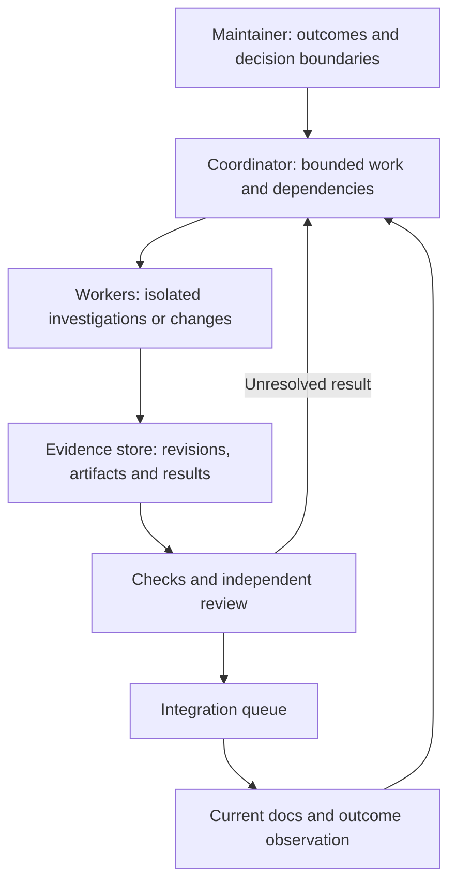

# Adapting the management framework to AI agent orchestration

> Status (2026-11-21): a proposal of 2026-11-17, landed as it was written; not the rule set in force. What governs, and
> what of this text is adopted, is in [the reconciliation](../framework-reconciliation.md). Only the links to pages
> outside this folder were changed so that they resolve from here.

Research date: 2026-11-17. Status: supporting research and original proposal. The [working framework](working-framework.md)
unifies and replaces the operating proposal below; its planned automation is not yet implemented.
Companion: [documentation process review](documentation-process-review.md), whose quantitative baseline is commit `65c78c47`.

## Recommendation

Use **bounded delegation, explicit state and evidence-based integration**. Start with a coordinator, a small set of workers, independently scoped verification and an integration queue. Increase autonomy and concurrency only when project-specific measurements justify them.

The term “swarm” does not specify an architecture. It may mean parallel calls, a hierarchy, peer negotiation or interacting autonomous agents. Choose the actual coordination structure per task. For this repository, a dependency graph with controlled integration is the initial hypothesis. A free-form group conversation is not a sufficient protocol for editing code and accepting scientific claims.

There are three distinct workloads:

| Workload | Appropriate starting arrangement | Success evidence |
|---|---|---|
| Developing rcfd | Bounded implementation workers over agreed interfaces; one integration queue | Accepted changes with reproducible tests, current docs and limited reviewer rework |
| Scientific investigation and design studies | Parallel alternative hypotheses or independent cases; serial execution within dependent numerical chains | Prespecified comparisons, provenance, uncertainty and recorded misses |
| Product discovery | Agents prepare alternatives, prototypes and research synthesis; people supply real observations and make consequential product choices | Actual user behaviour and useful engineering outcomes |

Do not evaluate all three using one “tasks completed” metric. An agent-created persona is an assumption, not a customer interview. A successful benchmark is not evidence of a useful product.

## What trustworthy sources actually establish

Trust attaches to a specific claim and method, not to the label “paper” or a vendor's reputation. Prefer primary sources with explicit tasks, baselines, costs, artifacts and limitations. Peer review helps, but does not make a result universal. A preprint may be informative while remaining provisional. A production report demonstrates experience in one setting, not a controlled comparison of every architecture.

| Source and authors | Type and useful result | Limit on transfer to rcfd |
|---|---|---|
| Michael Wooldridge, *An Introduction to Multiagent Systems*, 2nd ed.; [author's teaching resources](https://www.cs.ox.ac.uk/people/michael.wooldridge/pubs/imas/resources.html) | Established textbook foundation for agents, interaction, coordination and collective behaviour | Classical agent theory does not establish the reliability of today's LLM reasoning. |
| Herbert Simon, [The Architecture of Complexity](https://www.andrew.cmu.edu/course/15-440/assets/READINGS/simon-architecture-of-complexity-1962.pdf), 1962 | Foundational account of hierarchy and nearly decomposable systems | Applying it to worker boundaries is a design inference, not an LLM experiment. |
| Leslie Lamport, [Time, Clocks, and the Ordering of Events in a Distributed System](https://lamport.azurewebsites.net/pubs/time-clocks.pdf), 1978 | Formal foundation for ordering events and reasoning about distributed execution | Event order can establish what an agent saw; it cannot establish that its answer is scientifically correct. |
| Mert Cemri and colleagues, [Why Do Multi-Agent LLM Systems Fail?](https://proceedings.neurips.cc/paper_files/paper/2025/hash/b1041e52d3be19f0a9bc491657488e4a-Abstract-Datasets_and_Benchmarks_Track.html), NeurIPS 2025 Datasets and Benchmarks | MAST categorizes 14 failure modes in system design, agent alignment and verification, with 1,600+ annotated traces across seven frameworks | A useful failure checklist, not a population-wide forecast of our failure rate. |
| Yubin Kim and colleagues, [Towards a Science of Scaling Agent Systems, v3](https://arxiv.org/abs/2512.08296v3), April 2026 | Controlled study of 260 configurations across six benchmarks; benefits depend on task/architecture fit, with coordination overhead and error propagation important | Preprint; benchmark findings do not establish an optimal worker count for this codebase. Earlier summaries describe a smaller study; use the cited version. |
| Sayash Kapoor, Benedikt Stroebl, Zachary Siegel, Nitya Nadgir and Arvind Narayanan, [AI Agents That Matter](https://arxiv.org/abs/2407.01502), 2024 | Argues for joint assessment of cost and accuracy, holdouts and reproducibility | Evaluation principles, not proof that a particular orchestration framework wins. |
| Anthropic, [Building effective agents](https://www.anthropic.com/research/building-effective-agents), December 2024 | Practitioner guidance: simple composable workflows, routing, parallelization, orchestration and evaluation patterns | Vendor guidance; the page explicitly notes that tooling has changed. Retain principles, verify current APIs separately. |
| Jeremy Hadfield, Barry Zhang and colleagues, [How we built our multi-agent research system](https://www.anthropic.com/research/multi-agent-research-system), June 2025 | Production report on a lead agent delegating independent research, returning artifacts and evaluating results | Its reported 90.2% gain is on an internal research evaluation, not a coding-productivity result. |
| Anthropic, [Effective harnesses for long-running agents](https://www.anthropic.com/research/effective-harnesses-for-long-running-agents), 2025 | Describes incremental work, durable progress records, environment preparation and explicit testing across sessions | A worked engineering approach, not a general guarantee of long-horizon autonomy. |

Current frameworks expose mechanisms such as managers, handoffs, persistence and traces. Those are implementation capabilities. Their existence does not establish that agents are competent, evidence is independent or a task should be automated. Framework popularity is weak evidence for this project's architecture choice.

## What changes from first principles

The original management philosophies remain useful, but several operating assumptions change. The following adaptations are our synthesis, not positions attributed to those authors.

| Original concern | Changed assumption with AI workers | Adaptation |
|---|---|---|
| Cagan/Torres: discover value and usability before investing heavily | Producing plausible solutions and explanations becomes cheaper; access to real users does not | Explore alternatives more cheaply, but preserve explicit separation between generated hypotheses and observed needs. |
| Singer: fixed appetite, variable scope | A team-week is less informative when execution speed and worker count vary | Bound money/tokens, elapsed time, compute and human review attention. Define a stop rule. Scientific quality remains a constraint. |
| Reinertsen: optimize flow and control queues | Faster generation can overload verification, integration and review | Admit work at the rate downstream stages can accept it. Track queue age and rework, not worker utilization. |
| Deming/Ries: test predictions and learn | Workers can generate the proposal, its implementation and a flattering explanation of its result | Freeze important acceptance rules; use external measurements and independently scoped checks; make every contradiction visible. |
| Nygard: preserve rationale for future readers | Agents are frequent newcomers with partial, stale context | Supply compact current decisions with versioned links to history and explicit supersession. |
| Procida: organize documentation around reader needs | Documentation also feeds automated action | Keep human explanations alongside structured contracts and authoritative IDs. Generate repeated views rather than repeat prose. |

The goal becomes **useful, accepted, evidence-supported outcomes per unit of scarce resource**. Token price is only one component. Reviewer time, numerical compute, merge conflicts, debugging and the cost of a false scientific claim matter as well.

## Proposed operating model

These are responsibilities, not a requirement for six persistent agents. Most small tasks need fewer participants. Scripts should handle deterministic validation; models should handle reasoning where it adds value.

### 1. Give each task a bounded contract

Build on the roadmap and registration system. A worker receives:

- Item and outcome IDs; relevant accepted decisions and protocol revision.
- Base commit and allowed write scope, plus interfaces it must preserve.
- Deliverable and acceptance clauses; authoritative checks and fixed scientific limits.
- Dependencies and the evidence needed from them.
- Execution and review budget; stop/reconsider conditions.
- Decision rights, including which choices require escalation.
- Required result format and evidence location.

Return a patch/artifact reference, tested revision, commands, results, skips/misses, open questions and affected current pages. “Done” in a chat is a completion claim; the runtime records verification and acceptance separately.

The coordinator can revise a plan, but cannot silently convert a missed scientific threshold into a pass. A changed question or protocol receives a linked new registration.

### 2. Enforce shared state outside conversation

Use durable task states such as ready, leased, running, evidence-ready, verifying, accepted, integrated, blocked and cancelled. Distinguish execution failure from scientific disconfirmation: a correctly executed negative experiment can complete its task.

A task lease has an owner, attempt ID, expiry and heartbeat. A replacement attempt cannot publish over a newer owner. Dependencies reference accepted artifact versions, not a worker's informal description. Record state changes and artifact hashes in an append-only event history; derive a compact current view from it.

Use isolated workspaces for changes and a single integration queue. Shared schema, dependency versions, roadmap data and accepted policy have one controlled write path. Workers propose updates. Validate acceptance again against the integrated revision; branch-level success does not prove compatibility with intervening merges.

Retries need bounded policies. Recording the same result twice should not create two accepted tasks, two merges or duplicate simulation launches. Resuming an attempt should inspect durable state before repeating effects.

### 3. Make verification independent in the ways that matter

Separate claim generation, evidence collection and acceptance authority. A coordinator summarizes evidence; it should not be able to invent a successful test result or bypass a failed check.

For numerical work, independent checks can include analytic solutions, conservation identities, manufactured solutions, mesh/time refinement, held-out benchmarks and publicly sourced data. Their applicability depends on the specific claim. Existing tests are valuable but cannot establish all physical validity.

A different model or reviewer prompt may find additional mistakes, but shared sources and assumptions can still produce correlated errors. Do not count agent votes as independent scientific observations. A test derived from the same mistaken equation as the implementation can pass consistently.

Preserve preregistration and golden baselines. Protect policy, acceptance thresholds and expected results from routine worker edits through actual permissions or integration checks, not only prompt wording. Legitimate changes remain possible through an explicit recorded decision.

### 4. Schedule for dependencies and scarce resources

Parallelize independent source investigations, distinct numerical hypotheses and bounded components behind agreed interfaces. Keep tightly coupled solver changes with one owner until interface and invariants are explicit. Parallelize independent simulation candidates; keep continuation chains ordered.

Admit tasks according to build capacity, RAM/GPU limits, test slots and review capacity. A queue of unreviewed patches is unfinished work. Stop starting new work when acceptance capacity is saturated. There is no evidence-based reason yet to choose a large fixed swarm for rcfd.

## Applying this to the repository

| Existing asset | Proposed extension |
|---|---|
| Roadmap IDs, dependencies and acceptance text | Add links to outcomes, decisions, explicit check manifests and evidence revisions for active items. Preserve JSON as the delivery-status authority. |
| Prospective ADR registrations | Extract compact worker contracts; keep protocols distinct from decision and implementation status. |
| `scripts/adr_test_index.py` | Retain inferred historical links, labelled as inferred. Prefer explicit acceptance/check mappings for new work. |
| `scripts/gate_test.py` and gate attribution | Record exact attempts, revisions and environments. Treat attributed candidates as investigative leads unless a reproduced test establishes causality. |
| Per-merge checks in `docs/test-process.md` section 7.4 | Use them as the existing minimum integration procedure; model review adds evidence rather than replaces required checks. |
| Separate Studio npm/Playwright checks | Preserve their separate coverage. The Rust full gate alone says nothing about Studio behaviour. |
| Executable tutorials and site checks | Make worker closeouts identify affected user pages and reproduce relevant examples. Add structured current-claim checks where possible. |
| Large ADR histories and conflicting current views | Publish a compact accepted-decision index and regenerate repeated roadmap views through one controlled update path. |

This is an extension of the current evidence discipline. It does not require replacing the repo's tools with an agent framework. The first harness can be a thin scheduler/state store over existing worker, Git and test facilities.

## First pilot

Use a bounded documentation-consistency task because the earlier audit supplies objective defects. It exercises coordination without beginning with a numerical-method change.

1. Pin a baseline and independently specify acceptance: unique roadmap IDs; agreement of generated status/count views; source-backed capability and gate descriptions; valid documentation links. Preserve historical registrations.
2. Compare a single-worker arrangement against a small coordinator/worker/reviewer arrangement on independent comparable tasks or fresh isolated copies. Include orchestration overhead. If using repeated copies, prevent later attempts from receiving earlier solutions.
3. For the coordinated arrangement, assign separate investigations of roadmap consistency and capability/gate claims. Have one implementer apply accepted findings, followed by scoped verification and the existing integration checks.
4. Measure accepted correctness, elapsed time, total compute/token cost, maintainer review minutes, rework, duplicate effort and unsupported claims. Record blocked and failed attempts rather than excluding them.
5. Use fresh held-out defects and delayed review to detect overfitting or errors that survive initial acceptance. Fix thresholds and stopping rules before comparisons.

A pilot is not enough to estimate a universal productivity gain. Expand only if the arrangement improves the desired trade-off. Then try a bounded interface change, followed by independent numerical investigations with frozen protocols. More concurrency is a hypothesis to test.

## How to accumulate trustworthy local knowledge

Maintain a small evidence register: claim, source/version/date, evidence type, tested context, limitations, project decision and reconsideration trigger. Record adoption hypotheses separately from observed results. Pin model versions, instructions, tool definitions, environments and artifacts when possible. Exact model replay may not be available; reproducible acceptance checks still can be.

Use external work to choose plausible mechanisms and known failure cases. Use local controlled comparisons to establish what works here. Keep user outcomes, scientific validity and execution correctness separate throughout. That is how orchestration becomes an evidence-backed project capability rather than a collection of persuasive agent transcripts.
